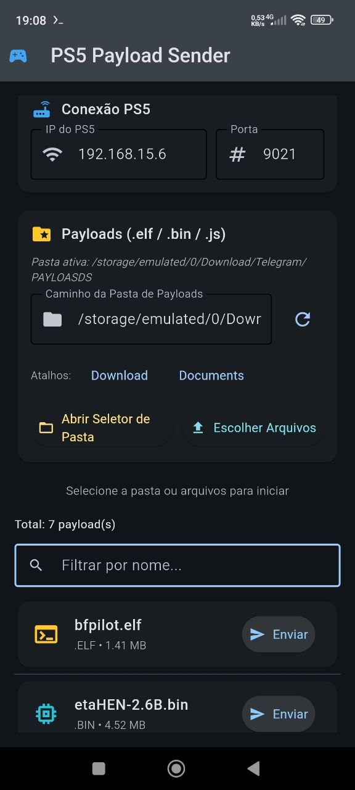

# PS5 Payload Sender



Aplicativo Android feito com [Flet](https://flet.dev/) para localizar e enviar payloads para um receptor TCP em um PS5 na mesma rede.

## Recursos

- Varre uma pasta e suas subpastas.
- Lista arquivos `.elf`, `.bin` e `.js`.
- Permite escolher vários arquivos manualmente.
- Exibe o tamanho e o caminho relativo de cada payload.
- Permite configurar IP e porta do receptor.
- Salva o último IP, porta e pasta utilizados.

## Uso

1. Conecte o celular e o PS5 à mesma rede local.
2. Informe o IP do PS5 e a porta em que o receptor está escutando.
3. Toque em **Abrir Seletor de Pasta** ou **Escolher Arquivos**.
4. Se escolher uma pasta, permita o acesso a todos os arquivos quando o Android solicitar.
5. Toque em **Enviar** ao lado do payload desejado.

> A porta depende do payload/receptor em execução no PS5. O aplicativo não presume uma porta única; informe a porta correta antes de enviar.

## Executar localmente

Requer Python 3.10 ou superior.

```bash
pip install -r requirements.txt
flet run main.py
```

## Gerar APK Android

```bash
flet build apk
```

Após instalar uma nova versão do APK, abra o seletor de pasta e conceda a permissão de gerenciamento de arquivos. Essa permissão é necessária para que o Android permita varrer os arquivos da pasta selecionada.

## Créditos

O envio TCP em [payload_sender.py](payload_sender.py) foi baseado no [`payload_sender.py` do projeto Y2JB](https://github.com/Gezine/Y2JB/blob/main/payload_sender.py), criado por [Gezine](https://github.com/Gezine). O projeto de origem é disponibilizado sob a [licença MIT](https://github.com/Gezine/Y2JB/blob/main/LICENSE).

## Aviso

Use este aplicativo somente em consoles, redes e ambientes para os quais você tenha autorização.
